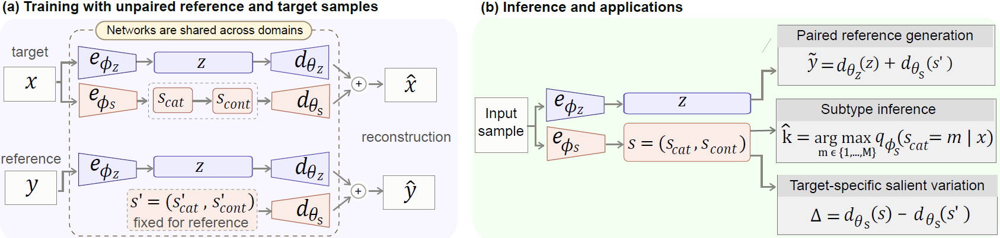

# CASL-VAE

**Learning Structured Latent Variables from Unpaired Data for Semi-supervised Clustering and Paired Sample Generation**

CASL-VAE learns shared variation, target-specific subtypes, and within-subtype variation from **unpaired reference and target samples**. It supports subtype discovery, paired sample generation, and individual target-specific variation estimation. Training requires reference/target labels, but no subtype labels or matched pairs.



Common and salient encoders separate shared and target-specific factors. Holding the common latent fixed and replacing the salient code with the reference preset generates a paired reference estimate.

## Installation

```bash
conda env create -f environment.yml
conda activate caslvae
```

## Input data

Provide one row per sample with domain label, covariates, and features:

```csv
subject_id,label,Age,Sex,ROI_1,ROI_2,ROI_3
sub-001,Background,63,1,3250,6100,4800
sub-002,Target,74,0,2900,5700,4300
```
Reference samples are denoted as **`Background`** label; all other labels are treated as target. Both groups are required. Age, sex, and intracranial volume can be used for optional covariate correction; categorical covariates must be encoded numerically.

Also supply a feature-list CSV where feature_names must match the data columns in the desired input order.
```csv
label,feature_names
1,ROI_1
2,ROI_2
3,ROI_3
```

## Training

Run from the repository root. Without arguments, these scripts use the included [synthetic dataset](docs/synthetic_data) containing 2,000 subjects and 145 ROIs, with covariate correction disabled. CUDA is used when available.
```bash
# Compare category counts M = 2, 3, 4, 5, 6
python scripts/check_cluster_stability.py

# Train with one reference and two target categories
python scripts/run_CASLVAE.py
```

Stability results are saved in caslvae_cluster_stability_output/; the trained checkpoint `model_checkpoint.pt`, preprocessing parameters, and monitoring plots are saved in caslvae_training_output/.

To process your own data, supply the data and feature-list CSVs:

```bash
python scripts/check_cluster_stability.py --data-file data.csv --feature-names features.csv --m-list 2 3 4 5 --output stability_results

python scripts/run_CASLVAE.py --data-file data.csv --feature-names features.csv --ncategories 3 --output training_results
```

For optional covariate correction, append --covariate-correct --covariates Age Sex ICV.
**`ncategories` includes the reference category:** `3` means one reference and two target categories. Reference is Python index `0`; keep `nLatent_s_cat=1`.

An optional split column in data file specifies train, validation, or test assignments. Without it, the scripts create splits automatically. Use --help to see available arguments.

## Inference

The trained model can be used to infer category probabilities, common and salient embeddings, reconstructions, and paired reference estimates. Target-specific variation is the reconstruction minus its paired reference; the deviation index is its mean absolute value across features.

See [Example Script](docs/README.md) for model setup, checkpoint loading, and inference. Reuse training preprocessing and feature order for new samples. 

### Synthetic example and latent plots
The [145-ROI notebook](docs/CASLVAE_synthetic_145ROIs.ipynb) generates cross-sectional reference/target data and trains CASLVAE. See the notebook for step by step instruction.

## Citation

If you use this code, please cite:

```bibtex
@misc{chintapalli2026casl,
  title={CASL-VAE: Learning Structured Latent Variables from Unpaired Data for Semi-supervised Clustering and Paired Sample Generation},
  author={Chintapalli, Sai Spandana and Chaudhari, Pratik and Davatzikos, Christos},
  journal={arXiv preprint arXiv:2607.08254},
  year={2026},
}
```

## License

Copyright (c) 2016 University of Pennsylvania. All rights reserved. See [https://www.med.upenn.edu/cbica/software-agreement-non-commercial.html](https://www.med.upenn.edu/cbica/software-agreement-non-commercial.html)

## Contact

Sai Spandana Chintapalli — [schinta@engineering.upenn.edu](mailto:schinta@engineering.upenn.edu)
