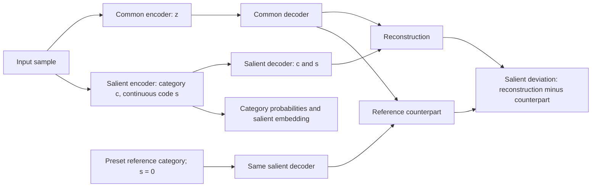

# CASL-VAE: Learning Structured Latent Variables from Unpaired Data

CASL-VAE learns **common variation**, **salient categories**, and **within-category variation** from unpaired reference and target samples.  

## Environment

```bash
conda env create -f environment.yml
conda activate caslvae
jupyter lab
```

[`environment.yml`](environment.yml) includes model, notebook, plotting, neuroimaging, RNA-seq, and survival-analysis dependencies. Supply your own datasets and update notebook paths. External comparisons such as SMILE-GAN and notebook-specific image-model modules require their separate implementations.

## Training workflow

Run the scripts from the repository root after setting the dataset/ROI-dictionary paths, feature and covariate lists, and output directory (`opt['path']`). These project-specific scripts also retain legacy imports that may need updating for your environment.

1. **Choose the categorical size `M`:** [`scripts/check_cluster_stability_realdata.py`](scripts/check_cluster_stability_realdata.py) compares candidate values in `M_list` using repeated training splits and pairwise adjusted Rand index (ARI) between the resulting target-sample partitions. Higher agreement supports a reproducible choice of `M`; this is clustering stability, not agreement with ground-truth subtypes. Outputs include `pairwise_ari_dict.pkl`, `pairwiseari.jpg`, and `clustering_results.pkl`.
2. **Train the model:** set `opt['ncategories']` to the selected `M` in [`scripts/run_CASLVAE_realdata.py`](scripts/run_CASLVAE_realdata.py), then run it to train CASL-VAE and save the model checkpoint, preprocessing information, and monitoring plots.

```bash
python scripts/check_cluster_stability_realdata.py
python scripts/run_CASLVAE_realdata.py
```

**`M = ncategories` includes the reference category**, so `M=3` represents one reference category and two target categories. `nLatent_s_cat=1` specifies one categorical latent variable and stays unchanged when comparing `M`.

## Model outputs



| Output | Interpretation |
|---|---|
| `z` | Common latent embedding shared across background and target populations. |
| `p(c \| x)` | Category probabilities; index `0` is reserved for reference/background. |
| `s` | Continuous variation within the inferred category. |
| Reconstruction | `D_common(z) + D_salient(c, s)`. |
| Reference counterpart | Keep `z` fixed; use `D_common(z) + D_salient(reference, 0)`. |
| Salient deviation | Reconstruction minus reference counterpart, in feature space. |

Training uses Gumbel-Softmax categories and Gaussian latent sampling. The objective combines reconstruction, latent-prior regularization, background salient-code penalties, common-latent MMD, reference/target classification, and inverse latent consistency. Group labels are required; target subtype labels are not.

## Input data

One row per sample; features must be finite numeric values in a consistent column order.

```text
subject_id,label,Age,Sex,ICV,ROI_1,ROI_2,...,ROI_D
sub-001,Background,65,F,1500000,3250,6100,...,4800
sub-002,Target,72,M,1600000,2900,5700,...,4300
```

Use the exact label **`Background`** for reference samples. `CreateDataset` treats every other label as target, without supervising target subtypes. Both groups must be present. Age, sex, and ICV are optional preprocessing covariates; the original network receives feature vectors. Encode categorical covariates numerically before enabling covariate correction. 

## Prepare data and instantiate

Run from the repository root, including when using a notebook:

```python
import sys
sys.path.insert(0, "code")

import pandas as pd
import torch
from torch.utils.data import DataLoader
from CASLVAE_model import CASLVAE
from data_utils import CreateDataset, train_test_split_unpaired

df = pd.read_csv("data/your_data.csv")
features = [column for column in df.columns if column.startswith("ROI_")] # or supply dataset specific feature names
train_x, train_labels, _, val_x, val_labels, _, stats = train_test_split_unpaired(
    df, feature_cols=features, label_col="label", covariate_cols=[],
    test_size=0.2, stratify=True, random_state=42, covariate_correct=False,
)
# Normalization uses training Background statistics for both splits.

opt = dict(
    nfeatures=len(features), nLatent_z=15, nLatent_s_cont=2,
    nLatent_s_cat=1, ncategories=3,  # reference + two target categories
    kl_z_lambda=1, kl_scat_lambda=1, kl_scont_lambda=1,
    kl_sconty_lambda=1, mmd_lambda=100, consistency_lambda=10,
    entropy_lambda=1, lr=1e-3, beta1=0.5, scheduler=False,
    DEVICE="cuda" if torch.cuda.is_available() else "cpu",
    epochs=500, batch_size=128, path="outputs",
)
model = CASLVAE()
model.create(opt)
model.set_preprocessing_params(dict(
    data_mean=stats.data_mean, data_std=stats.data_std,
    cov_min=stats.cov_min, cov_max=stats.cov_max, cov_beta=stats.cov_beta,
    covariate_correct=stats.covariate_correct,
    feature_names=features, covariate_names=[], tau=1.0,
))
loader = DataLoader(CreateDataset(train_x, train_labels),
                    batch_size=opt["batch_size"], shuffle=True)
reference, target = next(iter(loader))
losses = model.train_instance(target.float(), reference.float(), tau=1.0)
```

These coefficients are an example configuration. Adam uses weight decay `0.0025`; `entropy_lambda` weights the supervised reference/target BCE-style loss. Use `nLatent_s_cat=1` with the reference-preset implementation. The example performs **one training update**. [`code/train_utils.py`](code/train_utils.py) contains the epoch loop and temperature schedule; its generation-monitoring section currently uses CUDA tensors.

## Access outputs

This deterministic example uses posterior means and category probabilities instead of sampling:

```python
g = model.G_forward
g.eval()
x = torch.as_tensor(val_x[:8], dtype=torch.float32, device=opt["DEVICE"])
with torch.no_grad():
    z, _ = g.encode_common(x)
    logits, features_s = g.encode_salient_cat(x)
    probabilities = logits.softmax(-1)
    s = g.enc_s_cont(torch.cat([features_s, probabilities], dim=-1))
    reference_code = torch.zeros_like(probabilities)
    reference_code[:, 0] = 1
    common = g.decode_common(z)
    reconstruction = common + g.decode_salient(probabilities, s)
    counterpart = common + g.decode_salient(reference_code, torch.zeros_like(s))
    salient_deviation = reconstruction - counterpart
```

Outputs are standardized. Restore original units with `value * stats.data_std + stats.data_mean`; multiply differences by `stats.data_std` only. For prior-based paired generation, sample a common `z`, choose a target category, and sample `s` around `g.prior_s_cont(category)`, keeping the same `z` for its reference counterpart. Counterparts are model estimates, not guaranteed exact individual healthy anatomy.

Core files: [`CASLVAE_model.py`](code/CASLVAE_model.py) (objective/checkpoints), [`networks.py`](code/networks.py) (architecture), [`data_utils.py`](code/data_utils.py) (preprocessing), and [`train_utils.py`](code/train_utils.py) (training loop).
